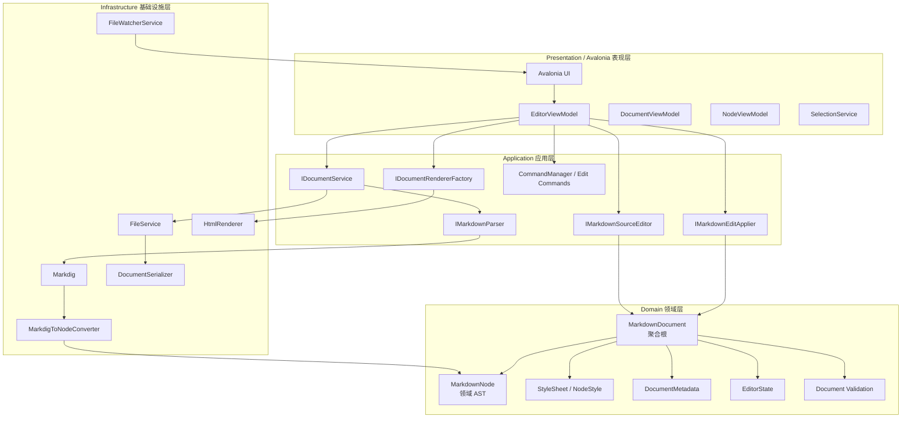
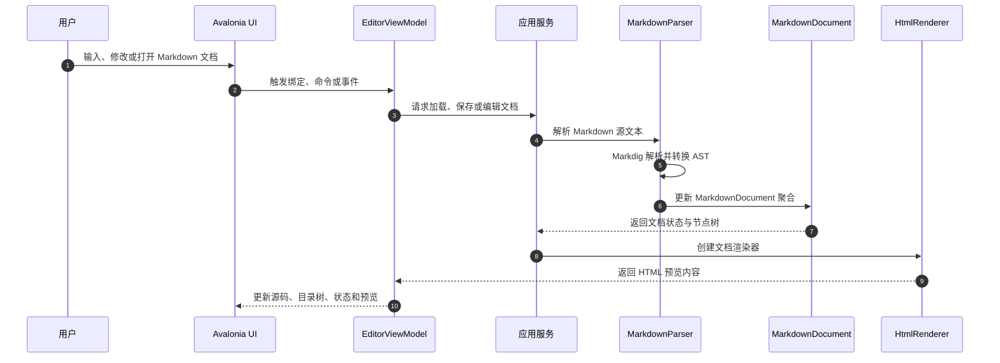
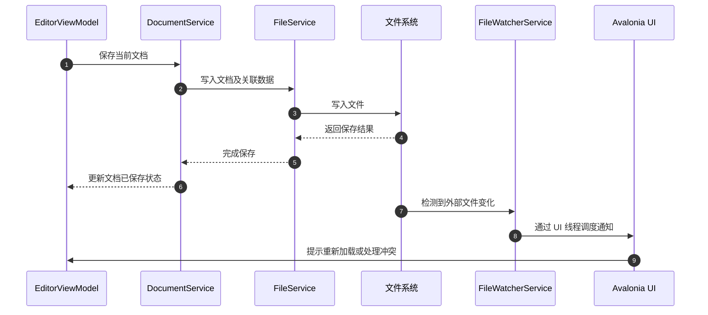

# CollabPlatform.Client.Hosts.Avalonia.MarkdownEditor

基于 **Avalonia** 的跨平台 Markdown 编辑器组件，采用 **领域驱动设计（DDD，Domain-Driven Design）** 的分层架构，将 Markdown 文本解析、内部抽象语法树建模、结构化编辑、样式管理、HTML 预览、文件持久化与文件变更监视等能力进行解耦。

项目以 `MarkdownDocument` 作为核心领域聚合根，使用统一的 `MarkdownNode` 领域 AST 承载文档结构，使 Markdown 源码、目录树、样式配置、编辑命令和渲染输出能够围绕一致的领域模型协作。

---

## 特性

- 基于 **Avalonia + MVVM** 的编辑器表现层与 ViewModel 支持；
- 采用 **DDD 模型驱动设计**，以领域模型而非第三方库 AST 作为系统核心；
- 基于 **Markdig** 构建 Markdown 解析管线，并在其前后扩展自定义语法；
- 支持常用 Markdown 扩展：
  - Pipe Tables（管道表格）；
  - Task Lists（任务列表）；
  - Footnotes（脚注）；
  - YAML Front Matter；
  - Emphasis Extras（插入/下标/上标等强调扩展）与 AutoLinks；
  - Mathematics（`$...$` 行内公式与 `$$...$$` / `\[...\]` 块公式）；
- 支持 **Mermaid 图表**代码块的解析与渲染标记；
- 支持 **Admonition 提示块**（`[!NOTE]` 等，含别名）与**自定义内容块**（`xxx:` 语法，优先级高于提示块）；
- 将 Markdig AST 转换为内部统一的 `MarkdownNode` 领域 AST；
- 支持标题、段落、列表、引用、表格、代码块、链接、图片、强调、删除线等节点建模；
- 支持文档树、标题层级和节点父子关系管理；
- 支持基于源码区间的 Markdown 编辑：
  - 文本范围替换；
  - 标题级别调整；
  - 撤销与重做；
- 支持解析后节点身份匹配，尽可能维持编辑过程中的节点标识稳定性；
- 支持 Markdown 节点样式、样式表、局部样式及样式变更追踪；
- 支持 HTML 渲染与实时预览；
- 预览更新采用防抖与取消机制，避免高频输入造成无效渲染；
- **大文档后台解析**：可按字符数阈值在同步解析与后台解析之间自动切换；
- **增量解析**：严格追加（尾部块复用与 Section 拼接）与中部编辑（前缀复用、后缀克隆平移、等长替换零克隆）快速路径，无法保证正确时回退全量；
- **流式预览块缓存与增量补丁协议**：稳态帧只重渲染变化块，并以 upsert/move/remove 块级补丁下发预览，传输量从整篇 HTML 降至数百字节；
- 流式未闭合围栏/公式的服务端门控，避免半截内容被反复高亮或错误渲染；
- 支持 Markdown 文档、样式、元数据和编辑器状态的持久化；
- 支持文档修订版本、保存状态、样式指纹及修改状态识别；
- 支持文件变更监视与 UI 线程调度抽象；
- 通过 `Microsoft.Extensions.DependencyInjection` 一键注册全部服务。

---

## 技术栈

| 技术 / 组件 | 用途 |
|---|---|
| [.NET](https://dotnet.microsoft.com/) | 运行时与开发平台 |
| [Avalonia](https://avaloniaui.net/) | 跨平台桌面 UI 框架 |
| [Markdig](https://github.com/xoofx/markdig) | Markdown 解析引擎 |
| `Microsoft.Extensions.DependencyInjection` | 依赖注入与服务组合 |
| MVVM | 表现层 UI 状态和交互管理 |
| DDD | 领域模型、聚合、分层架构与业务规则封装 |

---

## DDD 模型驱动设计

本项目采用 **领域驱动设计（DDD）** 思想构建 Markdown 编辑器，而不是让 UI、Markdig AST 或文件系统直接主导业务逻辑。

核心设计原则如下：

1. **领域模型是系统核心**  
   `MarkdownDocument` 是文档领域的聚合根，统一管理源码、AST、样式、元数据、编辑器状态、修订版本与保存状态。

2. **内部 AST 与第三方实现隔离**  
   Markdig 仅承担 Markdown 解析职责。其生成的 AST 会经由 `MarkdigToNodeConverter` 转换为内部统一的 `MarkdownNode` 领域模型，避免上层业务直接依赖第三方 AST。

3. **业务规则封装在领域层**  
   文档修改状态、节点树合法性、节点唯一标识、父子引用关系、编辑器选区归一化、样式指纹等规则由领域模型负责维护。

4. **应用层编排用例**  
   应用层通过接口定义文档打开、保存、解析、编辑和渲染等用例，协调领域对象与基础设施实现。

5. **基础设施可替换**  
   Markdig 解析、HTML 渲染、文件读写、序列化、文件监听等技术细节位于基础设施层，可在不破坏领域模型的前提下替换实现。

---

## 总体架构

项目遵循以下分层结构：

```text
Presentation → Application → Domain → Infrastructure
```



---

## 分层职责

| 层级 | 职责 | 主要组件 |
|---|---|---|
| `Presentation` | Avalonia UI 交互、数据绑定、命令触发、编辑器状态展示与 HTML 预览更新 | `EditorViewModel`、`DocumentViewModel`、`NodeViewModel`、`SelectionService` |
| `Application` | 编排文档打开、保存、解析、编辑、渲染等应用用例，对外提供抽象接口 | `IDocumentService`、`IMarkdownParser`、`IMarkdownSourceEditor`、`IMarkdownEditApplier`、`IDocumentRendererFactory` |
| `Domain` | 定义 Markdown 文档的核心业务模型、规则、状态与校验能力 | `MarkdownDocument`、`MarkdownNode`、`StyleSheet`、`DocumentMetadata`、`EditorState` |
| `Infrastructure` | 实现 Markdown 解析、AST 转换、HTML 渲染、文件读写、序列化和文件监视 | `MarkdownParser`、`MarkdigToNodeConverter`、`HtmlRenderer`、`FileService`、`FileWatcherService` |

---

## 核心领域模型

### `MarkdownDocument`

`MarkdownDocument` 是整个编辑器领域的**核心聚合根**，代表一个完整 Markdown 文档的业务状态。

```text
MarkdownDocument
├── Id                    文档唯一标识
├── FilePath              文档文件路径
├── SourceMarkdown        Markdown 原始文本
├── Root                  MarkdownNode AST 根节点
├── StyleSheet            文档样式表
├── Metadata              文档元数据
├── EditorState           编辑器状态
├── SourceRevision        源码修订版本
├── SavedSourceRevision   已保存源码修订版本
├── StyleRevision         样式修订版本
└── SavedStyleRevision    已保存样式修订版本
```

其主要职责包括：

- 维护 Markdown 源文本和解析后的节点树；
- 管理文档样式、元数据及编辑器状态；
- 标识源码与样式是否发生修改；
- 管理保存前后的修订版本；
- 校验 AST 根节点、节点 ID、父子关系等领域约束；
- 在文档更新后归一化光标位置、选区和已展开节点状态；
- 为样式、元数据和节点局部配置生成指纹，以辅助判断样式变更。

### `MarkdownNode`

`MarkdownNode` 是项目内部统一的 Markdown 抽象语法树节点模型。

每个节点可承载以下信息：

- 节点唯一标识；
- 节点类型与节点分类；
- 文本内容；
- 父节点及子节点；
- 标题层级；
- Markdown 源文本范围；
- 节点属性，例如链接地址、图片地址、代码语言；
- 关联样式标识与局部样式；
- 表格表头标记等结构化信息。

通过 `MarkdownNode`，项目将 Markdown 源码转换为可被目录树、结构化编辑器、样式系统和 HTML 渲染器共同使用的领域对象。

---

## Markdown 解析

项目使用 Markdig 作为底层 Markdown 解析引擎，并通过 `MarkdigToNodeConverter` 将 Markdig AST 转换为项目内部的 `MarkdownNode` AST。

默认支持以下解析扩展：

| 配置项 | 默认值 | 说明 |
|---|---:|---|
| `EnablePipeTables` | `true` | 启用管道表格解析。 |
| `EnableTaskLists` | `true` | 启用任务列表解析。 |
| `EnableFootnotes` | `true` | 启用脚注解析。 |
| `EnableYamlFrontMatter` | `true` | 启用 YAML Front Matter 解析。 |
| `EnableEmphasisExtras` | `true` | 启用插入、下标、上标等强调扩展。 |
| `EnableAutoLinks` | `true` | 启用裸链接自动识别。 |
| `EnableMathematics` | `true` | 启用行内/块级数学公式解析。 |

除 Markdig 扩展外，解析管线还包含项目自定义部分：

- **Mermaid**：` ```mermaid ` 围栏块输出专用节点属性，交由前端 Mermaid 渲染；
- **Admonition**：引用首行 `[!NOTE]` / `[!TIP]` / `[!WARNING]` 等标签（大小写不敏感，含语义别名）识别为提示块；
- **自定义内容块**：`xxx:` 形式的指令块，按语义分类映射，解析优先级高于 Admonition；
- **未闭合流式块**：`FenceStateScanner` 定位文末未闭合围栏，转换器在代码块、Mermaid、块公式上标记 `unclosed`，前端据此跳过高亮与渲染，闭合后自动恢复。

### Markdown 示例

````text
---
title: 示例文档
author: MarkdownEditor
---

# MarkdownEditor

- [x] 支持任务列表
- [ ] 支持未完成任务

| 名称 | 说明 |
| --- | --- |
| Markdown | 文档格式 |
| Avalonia | 跨平台 UI 框架 |

这是一个脚注示例。[^1]

[^1]: 脚注内容。

```csharp
Console.WriteLine("Hello MarkdownEditor");
```
````

---

## 编辑与预览流程



### 实时预览机制

`EditorViewModel` 负责协调文档服务、源码编辑服务、编辑应用器和 HTML 渲染器：

1. 文档被打开或修改后，ViewModel 获取当前 `MarkdownDocument`；
2. 使用 `IDocumentRendererFactory` 创建对应文档的渲染器实例（跨帧持有块缓存）；
3. 常规预览更新采用约 `300ms` 防抖，新输入会取消尚未完成的旧预览任务；
4. 增量补丁帧不经合并、立即下发，保证流式输入逐帧同步；
5. 渲染结果通过 UI 线程调度回写至 `HtmlPreview`（全量帧）或 `HtmlPatch`（补丁帧）；
6. 宿主只把补丁送往版本严格相邻的预览页，丢帧/页面刷新/补丁失败时自动请求全量自愈。

### 后台解析

编辑提交与 AST 解析解耦：`IMarkdownParser.ParseTree` 是只写新树的纯函数工作负载，可安全运行在后台线程。调度模式由 `MarkdownEditorOptions.BackgroundParsing` 控制：

| 模式 | 行为 |
|---|---|
| `Auto`（默认） | 文档小于 `BackgroundParsingThresholdChars`（默认 20000 字符）时同步解析，超过则后台解析 |
| `On` | 始终后台解析 |
| `Off` | 始终同步解析 |

后台路径为单消费者串行链（同一时刻最多一个解析在跑），通过版本号丢弃过期结果；保存、撤销/重做、文档切换与释放均有对应的收敛屏障，保证源码立即生效、AST 最终一致。

### 增量解析

`MarkdownParser` 在全量解析之外提供两条快速路径，任何结构前提不成立都回退全量解析，行为与全量等价：

- **严格前缀追加（流式出字）**：从追加点所在块向前回退探测“密封边界”（最多 8 块），边界之前的块对象直接复用（零解析、身份保持）；优先走“尾部 Section 拼接”，只重建尾部 Section 外壳并在尾部子序列间做身份匹配；
- **中部编辑（插入/删除/替换）**：取新旧源码公共前缀/后缀并对齐到行边界，前缀块复用、改动区重解析，后缀在偏移/行数无变化时直接复用，否则单趟深克隆并平移坐标；区间两侧做密封探测，不密封则各侧最多扩 8 块。

复用自已发布树的共享节点在新树构建期不覆写 `Parent`，延迟边记录在新根的账本上，由 `MarkdownDocument.ReplaceParsedRoot` 在文档锁内随换根一次性切换，保证并发的样式解析沿父链上行时只见完整旧树或完整新树。

### 流式渲染与增量补丁

预览渲染分两级：

1. **块缓存**：每个顶层块按节点 `Id` 缓存渲染片段，签名为“样式/图标版本 + 整块子树递归内容”的 FNV-1a 哈希；相同对象 + 相同 epoch 时直接备忘跳过子树折叠；
2. **块级补丁**：`IIncrementalPreviewRenderer` 比较相邻两帧的有序块序列，只输出新增/签名变化块的 upsert、相对顺序变化的 move、消失块的 remove；补丁体积或变化块比例超过阈值（默认 50%）时回退全量帧。

补丁以短字段 JSON（`t`/`id`/`after`/`html`，非 ASCII 不转义）下发，宿主页面端只按 `data-node-id` 操作顶层块，不做全文 `innerHTML`；代码高亮、KaTeX、Mermaid 增强只扫描本次新增块。

### 性能设计与大文档表现

编辑器针对 **10 万字符以上、预览 HTML 接近或超过 1 MB** 的文档做了全链路优化。这类文档若每帧全量解析 + 整篇传输 + 全树 DOM diff，流式输入会明显跌破 60 fps；项目把“每次按键只真正处理变化的局部”作为贯穿解析、渲染、传输和前端增强四层的核心原则。

#### 优化机制

| 层 | 机制 | 避免的 O(全文) 成本 |
|---|---|---|
| 解析 | 严格前缀追加快速路径（密封边界探测 + 尾部 Section 拼接） | 整篇 Markdig 解析、整篇 AST 转换、整篇 Section 重建 |
| 解析 | 中部编辑快速路径（前缀复用 / 后缀等长复用或单趟克隆平移） | 全文重解析；克隆热路径复用 Id 与样式引用，跳过 Guid/NodeStyle 分配 |
| 解析 | 身份匹配只在各层尾部子序列间进行（splice 路径） | 全树 NodeIdentityMatcher 遍历 |
| 渲染 | 顶层块按稳定 `Id` 缓存 HTML 片段，递归子树签名（FNV-1a 64） | 未变块的片段重新生成 |
| 渲染 | 引用级签名备忘：同节点对象 + 同 epoch 直接跳过整棵子树折叠 | 每帧 O(N) 的签名递归 |
| 渲染 | 块级补丁（upsert/move/remove）+ 50% 性价比阈值 | 整篇 HTML 的 StringBuilder 装配 |
| 传输 | 短字段 JSON、非 ASCII 不转义、补丁帧绕过 300ms 防抖 | 每帧约 1 MB 的 WebView 封送 |
| 前端 | 只按 `data-node-id` 操作顶层块，不做全文 `innerHTML`/morphdom；高亮、KaTeX、Mermaid 只扫描新增块 | 全树 DOM 解析/diff 与重复增强 |
| 并发 | 解析单消费者串行链 + 版本号丢弃过期结果；渲染串行门识别“渲染未发布”帧；渲染不长持文档锁 | 并发解析风暴、基线撕裂与 UI 长锁 |

正确性上，任何增量前提不成立（中间编辑落在未闭合围栏、引用定义跨区、边界不密封等）都回退全量解析/全量帧，行为与全量路径严格等价；补丁无法安全应用时前端返回 `reset`，宿主自动全量自愈。

#### 实测数据（约 26 万字符 / 255 KB 源码 / 2523 个顶层块）

基准文档最终 **261,162 字符（远超 10 万字符量级）**，单帧整篇 HTML 约 **903 KB～1.2 MB**，模拟 55 帧连续流式追加。以下为开发机 xUnit 内测量（仅托管侧，不含 WebView 传输与 JS 执行）：

| 指标 | 全量路径（无优化基线） | 优化后 |
|---|---|---|
| 大文档渲染平均 | 33.2 ms/帧（p95 51.8，max 69.8） | 暖全量 2.45 ms/帧；补丁路径 1.82 ms/帧（p95 4.6） |
| 大文档解析平均 | 42.0 ms/帧 | 增量解析 2.04 ms/帧 |
| 渲染提速 | — | 约 13.6×（暖全量）/ 18×（补丁） |
| 稳态每帧补丁 | 整篇 1205 KB | **1 个 op，平均载荷 445 B（p95 742 B，max 780 B）** |
| 载荷占比 | 100% | 约 0.036% |
| 引用备忘命中率 | — | 99.91%（136,080 命中 / 123 未命中） |
| 稳态块缓存命中率 | — | 99.96% |
| 全量回退帧 | — | **0** |

对照中等文档（38 KB / 253 块 / 119 帧）：渲染 2.05 → 0.13 ms/帧（约 15×），解析 1.80 → 0.20 ms/帧。中部编辑 36 KB / 60 帧：插入（后缀克隆平移）3.31 → 1.90 ms；等长替换（后缀零克隆）1.52 → 1.43 ms，末块复用率 98%。

#### 帧成本的三种形态

- **冷全量**：打开文档或样式 epoch 变更后的首帧，块缓存为空，约 18～33 ms（固定成本，不随输入重复支付）；
- **暖全量**：缓存命中但本帧仍装配整篇 HTML（样式变更、显式刷新、通道自愈），约 2.45 ms；
- **补丁帧**：稳态输入的常态，只生成并下发 1 个变化块，约 1.82 ms + 445 B。

#### 扩展规律与已知上限

托管侧暖路径近似线性，约 **1 ms / 千块**（含签名遍历、有序块 diff、整篇装配）；补丁已消除传输与前端的 O(全文) 成本，因此 2,500 块（约 26 万字符）规模下流式输入仍可保持流畅。按线性外推，约 1 万块（接近 1 MB 源码）时托管侧单帧可能接近一帧预算，届时剩余热点是托管侧的有序块全遍历，可通过签名与有序列表的“沿引用跳过”进一步降到 O(变化块)。

> 数据口径：xUnit 基准、测试程序集串行执行，毫秒数受机器负载与 GC/JIT 影响存在 ±10% 浮动；WebView2 的字符串封送、DOM 增删与浏览器内高亮/公式/图表渲染不在托管测量内，这部分恰是补丁协议收益最大的环节（载荷从 1.2 MB 降至 445 B、全树 morphdom 变为单次块插入）。对应基准见测试项目 `StreamingRenderBenchmarkTests`。

---

## 文档编辑与命令管理

项目通过命令模式管理编辑操作，便于支持撤销与重做。

```text
用户操作
  ↓
EditorViewModel
  ↓
编辑命令（ChangeTextCommand / ChangeHeadingLevelCommand）
  ↓
IMarkdownEditApplier + IMarkdownSourceEditor
  ↓
MarkdownDocument
  ↓
重新解析 / 更新预览
```

支持的典型操作包括：

- 文本区间替换；
- 标题级别调整；
- 命令栈撤销；
- 命令栈重做；
- 修改后 HTML 预览刷新；
- 修改状态同步更新。

---

## 文件保存与外部变更处理



文档领域模型通过源码修订版本、样式修订版本、已保存版本及样式指纹识别文档状态：

| 状态 | 说明 |
|---|---|
| `IsSourceModified` | Markdown 源码相对于保存版本已发生变化。 |
| `IsStyleModified` | 样式配置相对于保存版本已发生变化。 |
| `IsModified` | 源码或样式任一发生变化。 |
| `MarkSaved()` | 将当前状态标记为已保存。 |
| `Validate()` | 验证文档树与领域约束。 |

---

## 依赖注入

项目提供 `AddMarkdownEditor` 扩展方法，用于注册 Markdown 编辑器所需的领域、应用、基础设施和表现层服务。

```csharp
using CollabPlatform.Client.Hosts.Avalonia.MarkdownEditor.Presentation.Avalonia.Composition;
using Microsoft.Extensions.DependencyInjection;

var services = new ServiceCollection();

services.AddMarkdownEditor(options =>
{
    // MarkdownParserOptions：解析扩展
    options.EnablePipeTables = true;
    options.EnableTaskLists = true;
    options.EnableFootnotes = true;
    options.EnableYamlFrontMatter = true;
    options.EnableMathematics = true;

    // MarkdownEditorOptions：编辑器调度策略
    options.BackgroundParsing = BackgroundParsingMode.Auto;
    options.BackgroundParsingThresholdChars = 20000;
});

var serviceProvider = services.BuildServiceProvider();
```

默认注册的主要服务如下：

| 服务接口 / 类型 | 默认实现 | 生命周期 |
|---|---|---|
| `IMarkdownParser` | `MarkdownParser` | Singleton |
| `IDocumentSerializer` | `DocumentSerializer` | Singleton |
| `IFileService` | `FileService` | Singleton |
| `IDocumentService` | `DocumentService` | Singleton |
| `IMarkdownSourceEditor` | `MarkdownSourceEditor` | Transient |
| `IMarkdownEditApplier` | `MarkdownEditApplier` | Transient |
| `IDocumentRendererFactory` | `HtmlRendererFactory` | Transient |
| `EditorViewModel` | `EditorViewModel` | Transient |
| `IUiThreadDispatcher` | `AvaloniaUiThreadDispatcher` | Singleton |
| `IFileWatcherService` | `FileWatcherService` | Singleton |

---

## 使用示例

### 获取编辑器 ViewModel

```csharp
using CollabPlatform.Client.Hosts.Avalonia.MarkdownEditor.Presentation.Avalonia.ViewModels;

var editorViewModel = serviceProvider.GetRequiredService<EditorViewModel>();
```

### 打开 Markdown 文档

```csharp
await editorViewModel.OpenDocumentAsync("README.md");
```

### 保存当前文档

```csharp
await editorViewModel.SaveDocumentAsync();
```

### 修改指定源码范围内的文本

```csharp
var range = new SourceRange
{
    StartOffset = 0,
    Length = 10,
    StartLine = 1,
    StartColumn = 1,
    EndLine = 1,
    EndColumn = 11
};

editorViewModel.ExecuteTextChange(range, "# 新标题");
```

### 调整标题级别

```csharp
var document = editorViewModel.ActiveDocument?.Document;

if (document is not null)
{
    var heading = document.Root.Children
        .FirstOrDefault(node => node.Type == NodeType.Heading);

    if (heading is not null)
    {
        editorViewModel.ExecuteHeadingChange(heading, newLevel: 2);
    }
}
```

### 撤销与重做

```csharp
if (editorViewModel.CanUndo)
{
    editorViewModel.Undo();
}

if (editorViewModel.CanRedo)
{
    editorViewModel.Redo();
}
```

---

## 推荐项目结构

```text
CollabPlatform.Client.Hosts.Avalonia.MarkdownEditor
├── Application
│   ├── Abstractions
│   │   ├── Diagnostics
│   │   ├── Documents
│   │   ├── Editing
│   │   ├── Parsing
│   │   ├── Rendering
│   │   └── Threading
│   ├── Documents
│   └── Editing
│       └── Commands
├── Domain
│   ├── Documents
│   ├── Styling
│   ├── Syntax
│   │   ├── Factories
│   │   └── Matching
│   └── Validation
├── Infrastructure
│   ├── Exporting
│   ├── Parsing
│   ├── Persistence
│   │   └── Serialization
│   ├── Rendering
│   │   ├── Html
│   │   └── Style
│   └── Schema
└── Presentation
    └── Avalonia
        ├── Composition
        ├── Services
        └── ViewModels
```

---

## 未来扩展方向

- 完善 Markdown 节点类型与扩展语法支持；
- 提供更丰富的结构化编辑能力；
- 增加 HTML 安全策略与链接协议白名单配置；
- 增加图片、附件及资源文件管理；
- 支持多文档标签页；
- 支持文档差异比较与冲突合并；
- 支持协同编辑与操作日志同步；
- 支持导出 HTML、PDF 或其他文档格式；
- 支持自定义 Markdown 扩展与自定义渲染器。

---

## 设计目标

- **领域优先**：以 `MarkdownDocument` 和 `MarkdownNode` 作为系统稳定核心；
- **技术解耦**：隔离 Avalonia、Markdig、文件系统和渲染实现；
- **可测试性**：应用服务和基础设施服务均通过接口抽象；
- **可扩展性**：可替换解析器、渲染器、持久化方式和 UI 宿主；
- **一致性**：源码、AST、样式、元数据与编辑器状态围绕同一文档聚合协作；
- **工程化**：通过依赖注入、命令模式、修订版本和文件监听提升可维护性。

---

## License

本项目基于 **MIT License** 发布，Copyright © 2026 LungMaang，详见 [LICENSE.txt](LICENSE.txt)。